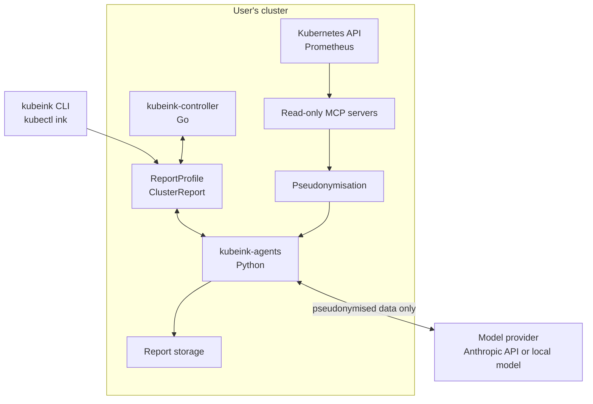

# kubeink architecture

- **Status:** Draft
- **Last reviewed:** 2026-11-22

This document describes what kubeink is, how its parts fit together and the
principles behind them. The reasons for each significant decision are recorded
in [`docs/adr`](../adr). The custom resources are specified in
[`api-v1alpha1.md`](api-v1alpha1.md) once they exist.

## Overview

kubeink writes status reports for Kubernetes and OpenShift clusters. A team of
AI agents analyses the state of the cluster and drafts the report, on a
schedule or in response to an event, and a person approves it before it is
delivered.

Most operations teams still write these reports by hand, with screenshots and
copied command output. Nearly everything in them comes from data the cluster
already exposes. What stops teams from handing the work to a language model is
that cluster data is confidential: node names, namespaces, internal registries
and error messages reveal how the platform is built. kubeink is designed around
that constraint.

## Goals

- Produce a complete, accurate report from a declarative profile, without
  manual steps.
- Never send a real identifier from the cluster to a model.
- Keep every figure in the report traceable to the data it came from.
- Work without AI, as a data-only report, when no model is configured.
- Run inside the cluster as a Kubernetes operator, with read-only access.

## Non-goals

- **Monitoring.** kubeink reads Prometheus and the Kubernetes API; it does not
  replace them, Alertmanager or Grafana.
- **Remediation.** kubeink never changes the cluster, and neither do its
  agents.
- **Unattended delivery.** A report is delivered only after a person approves
  it.

## Components

| Component | Language | Role |
| --- | --- | --- |
| `kubeink-controller` | Go | Kubernetes operator: reconciles profiles, schedules and events, and creates a `ClusterReport` for each run |
| `kubeink-agents` | Python | Collects data, pseudonymises it, runs the agent team and renders the report |
| `kubeink` CLI | Go | Starts, inspects and approves reports from outside the cluster; also a `kubectl` plugin |

The two in-cluster components share no code and no network API. They meet only
through the custom resources:

- **ReportProfile** is written by users. It declares what a report includes and
  excludes, the redaction rules, the model, the output format and the triggers.
- **ClusterReport** is created by the controller for each run. It records the
  period covered, the progress of the run and where the result was stored. It
  is the contract between the controller and the agents, and the audit record
  of the report.

If the agents fail, the report stays pending and the controller keeps working.

## Report lifecycle

1. A schedule or an event triggers a `ReportProfile`.
2. The controller creates a `ClusterReport` owned by the profile.
3. `kubeink-agents` picks it up and runs the collectors, which read the
   Kubernetes API and Prometheus through read-only MCP servers.
4. Every identifier in the collected data is replaced by a stable alias.
5. Specialist agents analyse each area and return structured findings.
6. A writer agent drafts the report from the findings.
7. A verifier checks that every figure and resource in the draft exists in the
   collected data. A section that fails goes back to the writer, and after
   repeated failures it is flagged for human review.
8. The aliases are replaced with the real names, the report is rendered and
   stored, and the `ClusterReport` waits for approval.
9. A person approves the report, and it is marked as delivered.

## Agent team

The agents are built with the Claude Agent SDK. Each one has a single job and
only the tools that job needs.

- **Orchestrator.** Plans the report from the profile, starts the specialists
  in parallel and gathers their findings. A section that fails is marked in
  the report instead of failing the whole run.
- **Specialists.** One per area: nodes and capacity, workloads, storage,
  control plane and certificates, autoscaling, and OpenShift where it applies.
  Each returns findings that are validated against a schema.
- **Writer.** Turns findings into prose in the language and tone of the profile.
- **Verifier.** Compares every claim in the draft with the collected data.

The model never produces a number. Figures come from the collectors and are
placed in the report by the renderer; the model explains them.

## Privacy and security

- **Reversible pseudonymisation.** Names of nodes, namespaces, workloads,
  secrets, registries, images, paths, IP addresses and domains are replaced by
  stable aliases such as `NODE_07` or `NS_12` before any model call. The
  mapping never leaves the cluster.
- **Free-text scrubbing.** Event messages and logs are filtered with
  configurable rules, because identifiers also appear inside error messages.
- **Pre-flight check.** If any real value from the mapping appears in an
  outgoing request, the call is cancelled and the report is flagged.
- **Least privilege.** Service accounts can only read, and a NetworkPolicy
  allows egress only to the configured model provider.
- **Untrusted input.** Cluster data, logs and model output are untrusted. The
  agents never follow instructions found in them and never pass them to a
  shell.
- **Local models.** An adapter for models served inside the user's network,
  for environments where no data may leave it.
- **Secrets.** Provider credentials are referenced through Secrets, never
  stored in a resource.

## Extensibility

Both components follow a ports and adapters architecture. Model providers,
data sources, output formats and report storage are adapters, so new ones are
added without changing the core.

## Open questions

- Where reports and their history are stored: a PersistentVolumeClaim or
  S3-compatible object storage.
